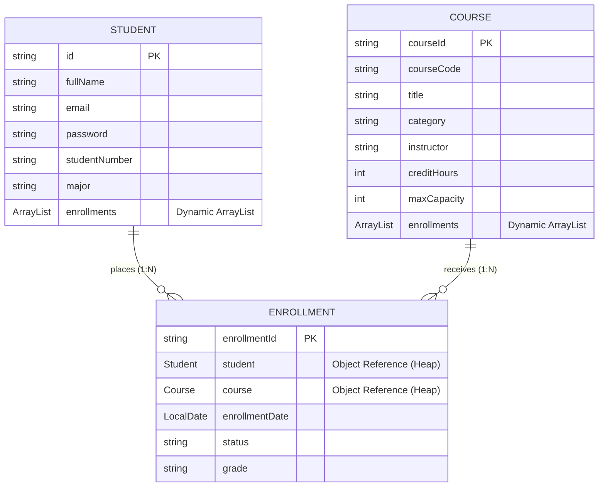

# LearnHub – Online Course Portal

> **Online Portal Mapping**: Build a Java class structure utilizing dynamic array storage and reference passing to model many-to-many (M:N) ER relationships between students and online courses.

[](https://www.oracle.com/java/)
[](https://spring.io/projects/spring-boot)
[]()
[]()

---

## 📌 Problem Statement Overview

An online education management website where students can register, log in, view available online courses, and enroll in multiple courses. The admin is able to add courses, manage students, and view which students are enrolled in each course.

The system demonstrates five core Java computer science principles:
1. **Classes and Objects**: Robust object-oriented domain hierarchy (`User`, `Student`, `Admin`, `Course`, `Enrollment`).
2. **Dynamic Array Storage (`ArrayList`)**: Dynamic heap resizing for course offerings, student rosters, and enrollments without fixed array boundaries.
3. **Object Reference Passing**: Direct heap memory reference passing between `Student`, `Course`, and the associative `Enrollment` entity—ensuring zero data duplication.
4. **Many-to-Many (M:N) ER Relationships**: Bidirectional navigation (`student.getEnrolledCourses()` and `course.getEnrolledStudents()`).
5. **Data Management using Java**: In-memory service repository managing registration, enrollment constraints, seat availability, and reference cleanups upon course drops.

---

## 🏗️ Architecture & Entity-Relationship (M:N) Diagram



---

## 💡 How Key Java Concepts are Demonstrated

### 1. Dynamic Array Storage (`ArrayList`)
In static arrays (`Course[]`, `Student[]`), capacities are fixed at compilation or initialization. In LearnHub:
- Every `Student` maintains `private final ArrayList<Enrollment> enrollments = new ArrayList<>()`.
- Every `Course` maintains `private final ArrayList<Enrollment> enrollments = new ArrayList<>()`.
- As students enroll or drop courses, the lists expand and shrink dynamically:
  ```java
  student.addEnrollment(enrollment); // Dynamically resizes
  course.addEnrollment(enrollment);
  ```

### 2. Object Reference Passing
When an enrollment is created, references to the existing `Student` and `Course` heap instances are passed into the constructor:
```java
public Enrollment(String enrollmentId, Student student, Course course, LocalDate enrollmentDate) {
    this.enrollmentId = enrollmentId;
    this.student = student; // Direct object reference passing
    this.course = course;   // Direct object reference passing
    this.enrollmentDate = enrollmentDate;
    this.status = "ACTIVE";
}
```
**Advantage**: If a course's instructor or title is updated, inspecting that course from *any* enrolled student immediately reflects the changes because both point to the identical memory address.

### 3. Many-to-Many (M:N) ER Mapping via Associative Entity
- **One Student $\rightarrow$ Multiple Courses**: Alice is enrolled in Java, Python, and Web Development.
- **One Course $\rightarrow$ Multiple Students**: Java CS101 has Alice, Bob, and Diana.
- Bidirectional traversal helper methods:
  - `student.getEnrolledCourses()` traverses `student.getEnrollments()` to collect `Course` references.
  - `course.getEnrolledStudents()` traverses `course.getEnrollments()` to collect `Student` references.

---

## 🚀 Features

### 🎓 Student Portal
- **Registration & Authentication**: Student signup with major/department selection.
- **Course Catalog**: Filter by category, search by title/instructor, view real-time seat availability.
- **Enrollment Action**: Enroll in multiple courses with duplicate enrollment prevention and capacity checks.
- **My Courses**: View active enrollments with grades and enrollment dates.
- **Drop Course**: Cleanly removes object references dynamically from both the Student's and Course's collections.

### 🛡️ Administrator Console
- **Add Online Courses**: Define course code, title, category, instructor, credits, and seat capacity.
- **Course Roster View**: Select any course to view all enrolled students.
- **Student Roster View**: Select any student to inspect all their registered courses.
- **Master Enrollment Registry**: Full table of all associative M:N connections.
- **KPI Metrics**: Real-time stats on active students, courses, seat utilization, and average courses per student.

### 🔬 Interactive Concept Visualizer (`/concept`)
- Dedicated visual page explaining the Java memory model, heap reference passing, and live tabular state of all active pointers.

---

## 🔑 Pre-seeded Testing Accounts

The system starts pre-seeded with realistic data to demonstrate Many-to-Many mapping immediately:

| Role | Name | Email | Password | Pre-seeded Enrollments |
| :--- | :--- | :--- | :--- | :--- |
| **Admin** | Portal Administrator | `admin@learnhub.com` | `admin123` | *Full Management Access* |
| **Student** | Alice Johnson | `alice@example.com` | `pass123` | Java, Python, Web Dev (3 courses) |
| **Student** | Bob Smith | `bob@example.com` | `pass123` | Java, Database Systems (2 courses) |
| **Student** | Charlie Davis | `charlie@example.com` | `pass123` | Python, Web Dev, Cloud (3 courses) |
| **Student** | Diana Prince | `diana@example.com` | `pass123` | Java, Cloud Architecture (2 courses) |

---

## 💻 Running the Application

### Prerequisites
- **Java 17+**
- **Maven 3.8+**

### 1. Build and Run Unit Tests
```bash
mvn clean test
```
*Executes all 15 unit and integration tests verifying dynamic arrays, reference passing, and M:N relationships.*

### 2. Launch the Web Application
```bash
mvn spring-boot:run
```
Or run the packaged JAR:
```bash
mvn clean package
java -jar target/learnhub-portal-1.0.0.jar
```

### 3. Access in Browser
- **Portal Home**: [http://localhost:8080](http://localhost:8080)
- **Concept Deep Dive**: [http://localhost:8080/concept](http://localhost:8080/concept)
- **REST API Stats**: [http://localhost:8080/api/stats](http://localhost:8080/api/stats)
- **REST API Courses**: [http://localhost:8080/api/courses](http://localhost:8080/api/courses)

---

## 📁 Project Structure

```
Netfleet/
├── pom.xml
├── README.md
└── src/
    ├── main/
    │   ├── java/com/learnhub/
    │   │   ├── LearnHubApplication.java
    │   │   ├── controller/
    │   │   │   ├── AdminController.java       # Admin dashboards, course creation, roster views
    │   │   │   ├── ApiController.java         # REST endpoints for courses, students, stats
    │   │   │   ├── AuthController.java        # Login, registration, session management
    │   │   │   ├── HomeController.java        # Landing page and concept visualizer
    │   │   │   └── StudentController.java     # Course browsing, enrollment, drop flows
    │   │   ├── model/
    │   │   │   ├── Admin.java                 # Administrator entity (subclass of User)
    │   │   │   ├── Course.java                # Course entity with ArrayList<Enrollment>
    │   │   │   ├── Enrollment.java            # Associative M:N entity holding Student & Course references
    │   │   │   ├── Role.java                  # User roles enum
    │   │   │   ├── Student.java               # Student entity with ArrayList<Enrollment>
    │   │   │   └── User.java                  # Abstract base class
    │   │   └── service/
    │   │       └── LearnHubService.java       # In-memory data management & M:N engine
    │   └── resources/
    │       ├── application.properties
    │       ├── static/css/style.css
    │       └── templates/
    │           ├── concept-map.html           # Visual reference passing & M:N guide
    │           ├── index.html                 # Main landing page
    │           ├── login.html                 # Sign-in with 1-click test credentials
    │           ├── register.html              # Student registration
    │           ├── admin/                     # Admin views (dashboard, courses, students, enrollments)
    │           ├── student/                   # Student views (dashboard, courses, my-courses, profile)
    │           └── fragments/                 # Shared navbar, header, alerts, footer
    └── test/
        └── java/com/learnhub/
            ├── ManyToManyRelationshipTest.java # 6 core M:N, ArrayList, and reference passing tests
            └── WebControllerTest.java          # 9 web MVC and REST API integration tests
```

---

## 🧪 Test Suite Summary

The automated test suite runs 15 comprehensive tests covering:
- ✅ Dynamic memory expansion and shrinkage via `ArrayList.add()` and `ArrayList.remove()`
- ✅ Object reference equality (`assertSame`) proving shared heap memory addresses
- ✅ Heap mutation reflection across references without database roundtrips
- ✅ Many-to-Many bidirectional navigation:
  - 1 Student in multiple courses
  - 1 Course with multiple students
- ✅ Duplicate enrollment rejection (`IllegalStateException`)
- ✅ Mutual reference cleanup upon unenrollment / drop
- ✅ Maximum course capacity enforcement
- ✅ Web MVC controller endpoints and JSON REST APIs
